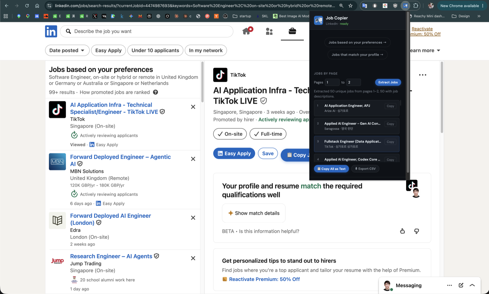
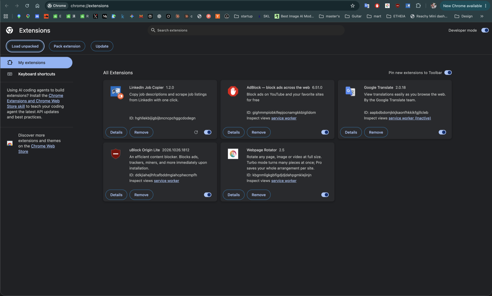
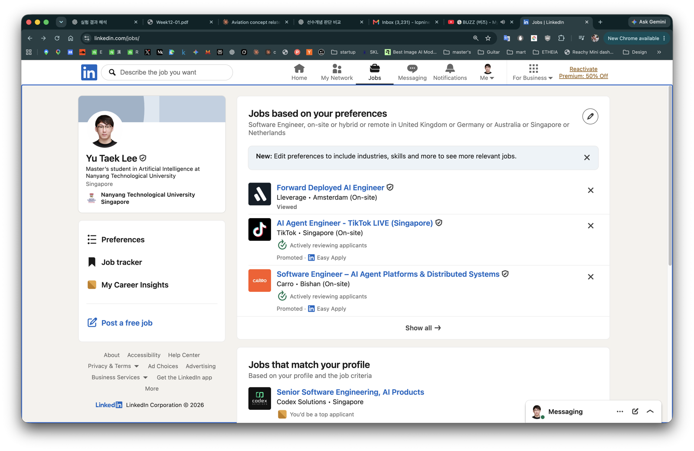

# LinkedIn Job Copier

[English](README.md) | **한국어**

LinkedIn 채용 공고를 일일이 복사·붙여넣기 하지 않아도 되게 해 주는 브라우저 확장 프로그램입니다.

- **공고 하나 복사:** 버튼 한 번으로 직무명, 회사, 근무지, 링크, 상세 설명 전체를 복사합니다. 문서, 메시지, ChatGPT/Claude 등에 바로 붙여넣을 수 있어요.
- **여러 공고 한 번에 모으기:** 검색 결과 페이지 범위(예: 1~3페이지)를 고르면 그 안의 공고를 상세 설명까지 전부 모아 줍니다. 한 번에 많은 페이지들을 선택하면 메모리 이슈가 발생할 수 있으니 최대 3페이지까지 추천드립니다.
- **목록 저장:** 텍스트로 복사하거나, Excel·Numbers·Google 스프레드시트에서 열 수 있는 CSV 파일로 내려받을 수 있습니다.



**지원 브라우저:** 컴퓨터용 Chrome, Edge, Brave, Arc, Vivaldi, Opera (Chromium 기반 브라우저). 휴대폰, Safari에서는 동작하지 않고, Firefox에서는 코드를 고쳐야 쓸 수 있습니다.

**개인정보:** 모든 작업은 내 브라우저 안에서만 이뤄집니다. LinkedIn 외의 다른 서버로는 아무 데이터도 보내지 않습니다.

---

## 설치하기 (약 2분)

Chrome 웹 스토어에 올라가 있지 않아서 폴더에서 직접 설치합니다. 처음 한 번만 하면 됩니다.

### 1. 확장 프로그램 내려받기

1. 이 GitHub 페이지에서 초록색 **Code** 버튼을 누르고 **Download ZIP**을 클릭합니다.
2. 내려받은 ZIP 파일(보통 **다운로드** 폴더에 있어요)을 더블클릭해 압축을 풉니다.
3. 압축을 푼 폴더를 **문서** 폴더처럼 실수로 지우지 않을 곳으로 옮겨 두세요. 브라우저는 이 폴더에서 확장 프로그램을 불러오기 때문에 **폴더를 지우면 확장 프로그램이 작동하지 않습니다.**

### 2. 브라우저에 추가하기

1. 새 탭을 열고 주소창에 아래 주소를 입력한 뒤 Enter를 누릅니다.
   - Chrome: `chrome://extensions`
   - Edge: `edge://extensions`
   - Brave: `brave://extensions`
2. **오른쪽 위**에 있는 **개발자 모드(Developer mode)** 스위치를 켭니다.
3. 왼쪽 위의 **압축해제된 확장 프로그램을 로드합니다(Load unpacked)**를 클릭합니다.
4. 압축을 푼 폴더(`manifest.json` 파일이 들어 있는 폴더)를 선택하고 **선택**을 누릅니다.

확장 프로그램 목록에 **LinkedIn Job Copier**가 스위치가 켜진 상태로 보이면 설치가 끝난 거예요.



### 3. 툴바에 고정하기

브라우저 오른쪽 위의 퍼즐 조각 아이콘(🧩)을 누르고 **LinkedIn Job Copier** 옆의 핀을 클릭하세요. 파란색 아이콘이 툴바에 항상 표시되어 바로 누를 수 있습니다.

> **Edge 사용자:** 확장 프로그램을 유지할지 물어보면 **유지**를 선택하세요.
> **Chrome 사용자:** 개발자 모드 확장 프로그램에 대한 안내가 가끔 뜰 수 있습니다. 이 방식으로 설치하면 원래 뜨는 안내이니 닫으면 됩니다.

---

## 사용하기

먼저 같은 브라우저에서 LinkedIn에 로그인해 주세요.

### 여러 페이지의 공고 한 번에 모으기

1. 공고 검색 결과 목록을 엽니다. 방법은 두 가지예요.
   - **확장 프로그램에 맡기기 (가장 쉬움):** 툴바의 확장 프로그램 아이콘을 누르고 **Jobs based on your preferences →** 또는 **Jobs that match your profile →**를 클릭합니다. 어느 웹페이지에서 눌러도 됩니다. 확장 프로그램이 LinkedIn 채용 페이지를 열고, 해당 섹션의 **Show all**을 대신 눌러 전체 목록으로 자동 이동합니다.
   - **직접 들어가기:** [linkedin.com/jobs](https://www.linkedin.com/jobs/)에서 **Jobs based on your preferences** 또는 **Jobs that match your profile** 섹션 아래의 **Show all**을 클릭합니다. (평소처럼 LinkedIn에서 직무를 검색해도 됩니다.)

   

   페이지 범위 입력 칸은 이런 검색 결과 목록 화면에서만 나타납니다.
2. 확장 프로그램 아이콘을 누릅니다. **JOBS BY PAGE** 아래에 원하는 페이지(예: **1**부터 **3**까지)를 입력하고 **Extract Jobs**를 클릭합니다.
3. 확장 프로그램이 페이지를 하나씩 넘기며 공고를 모을 때까지 기다립니다. LinkedIn은 한 페이지에 공고를 25개 정도 보여 주기 때문에 2페이지면 1분 정도 걸려요. 기다리는 동안 작은 창을 닫고 다른 일을 해도 됩니다. 진행 상황은 아이콘을 다시 눌러 확인하고, 중간에 그만두려면 **Stop**을 누르세요.
4. 끝나면 *"Extracted 50 unique jobs from pages 1–2"* 같은 메시지와 함께 공고 목록이 나타납니다. 그다음에는:
   - **📋 Copy All as Text**: 모든 공고와 상세 설명을 복사합니다. 원하는 곳에 붙여넣으면 됩니다.
   - **⬇ Export CSV**: 스프레드시트 파일을 내려받습니다. Excel, Numbers, Google 스프레드시트(*파일 → 가져오기*)에서 열 수 있어요.
   - 공고 옆의 **Copy**: 그 공고 하나만 복사합니다.

### 팁: AI에게 나와 맞는 공고 골라 달라고 하기

모은 목록을 내 이력서(CV)와 함께 AI(ChatGPT, Claude, Gemini 등)에 넣으면 나에게 맞는 공고를 골라 줍니다.

1. **📋 Copy All as Text**를 누릅니다. 파일로 받고 싶다면 **⬇ Export CSV**를 누르세요.
2. AI를 열고 이력서(PDF나 Word 파일)를 첨부하거나 이력서 내용을 붙여넣습니다.
3. 복사한 공고 목록을 붙여넣고(또는 CSV 파일을 첨부하고) 이렇게 물어보세요.

   > 내 이력서와 채용 공고 목록이야. 내 경력에 가장 잘 맞는 공고를 골라서 순위를 매기고, 각각 왜 잘 맞는지와 내가 부족할 수 있는 점을 설명해 줘.

공고 50개 이상을 직접 읽는 대신, 지원할 만한 공고만 추린 짧은 목록을 받을 수 있습니다.

### 공고 하나만 복사하기

1. LinkedIn에서 아무 공고나 클릭해 오른쪽에 상세 내용이 열리게 합니다.
2. LinkedIn의 **Save** 버튼 옆에 있는 파란색 **📋 Copy Job Description** 버튼을 클릭합니다(위의 첫 번째 스크린샷에서 볼 수 있어요).
3. 필요한 곳에 붙여넣으면 됩니다.

---

## 자주 묻는 질문

**Extract Jobs 버튼이나 페이지 입력 칸이 안 보여요.**
LinkedIn 검색 결과 목록 화면이 아니어서 그렇습니다. 확장 프로그램의 바로가기 버튼을 누르거나 LinkedIn에서 직무를 검색한 다음, 확장 프로그램을 다시 열어 보세요.

**Copy Job Description 버튼이 안 나타나요.**
LinkedIn 페이지를 새로고침하세요(F5, Mac은 ⌘R). 확장 프로그램을 방금 설치했다면, 이미 열려 있던 LinkedIn 탭은 새로고침해야 작동합니다.

**일부 공고에 상세 설명이 없어요.**
요청이 짧은 시간에 많이 몰리면 LinkedIn이 응답을 늦추기도 합니다. 몇 분 기다렸다가 페이지 범위를 줄여서 다시 해 보세요.

**요청한 마지막 페이지까지 가기 전에 멈췄어요.**
그 검색 결과에 그만큼 페이지가 없는 겁니다. 그때까지 찾은 공고는 모두 남아 있어요.

**아예 작동하지 않아요.**
LinkedIn이 웹사이트 구조를 바꾸면 확장 프로그램이 동작하지 않을 수 있습니다. 이 페이지에 새 버전이 올라왔는지 확인해 주세요.

### 새 버전으로 업데이트하기

1. ZIP 파일을 다시 내려받아 압축을 풉니다.
2. 기존 확장 프로그램 폴더를 새 폴더로 바꿉니다(위치는 그대로 두세요).
3. `chrome://extensions`에 들어가 LinkedIn Job Copier 카드의 **↻ 새로고침** 화살표를 누릅니다.
4. 열려 있는 LinkedIn 탭을 새로고침합니다.

### 삭제하기

`chrome://extensions`에 들어가 LinkedIn Job Copier 카드의 **삭제(Remove)**를 누릅니다. 그다음 폴더를 지워도 됩니다.

---

## 개발자용 안내

### 페이지 범위 추출 방식

- LinkedIn의 페이지 버튼(**Page N**, **Next**/**Previous**)을 직접 눌러 페이지를 이동하고, 결과 목록이 바뀔 때까지 기다린 뒤 각 페이지에 있는 카드의 job ID를 모읍니다.
- 그다음 페이지로 넘어가기 전에, 새로 찾은 공고의 직무명·회사·근무지·상세 설명을 LinkedIn의 공개 공고 페이지(`/jobs-guest/jobs/api/jobPosting/{JOB_ID}`)에서 3개씩 동시에 읽어 옵니다.
- 여러 페이지에 중복으로 나온 공고는 하나만 남깁니다. 요청한 페이지가 없으면 거기서 멈추고 그때까지 모은 결과를 유지합니다.
- 목록을 스크롤하지 않기 때문에 LinkedIn이 화면에 렌더링한 카드만 수집됩니다.
- 팝업을 닫아도 진행은 계속됩니다. 읽어 오지 못한 공고(예: LinkedIn이 요청을 제한한 경우)는 카드에 보이던 정보만 남습니다.
- CSV 열 순서는 `jobId,title,company,location,jobUrl,aboutTheJob`입니다.
- content script는 `linkedin.com/jobs/*`에서만 실행됩니다. LinkedIn 마크업이 바뀌면 `content.js`의 구조 선택자를 수정해야 할 수 있습니다.

### 테스트 실행

```bash
node --test
```

### 파일 구조

```
linkedin-job-copier/
├── manifest.json      # 확장 프로그램 설정 (Manifest V3)
├── content.js         # LinkedIn 페이지에 삽입: Copy 버튼과 페이지 범위 추출
├── content.css        # 삽입된 버튼과 토스트 스타일
├── popup.html         # 팝업 UI
├── popup.css          # 팝업 스타일
├── popup.js           # 팝업 로직
├── test/              # 테스트
├── docs/screenshots/  # README에 쓰인 이미지
└── icons/
    ├── icon16.png
    ├── icon48.png
    └── icon128.png
```

---

[PavanBJ/linkedin-job-copier](https://github.com/PavanBJ/linkedin-job-copier)를 바탕으로 만들었습니다.
