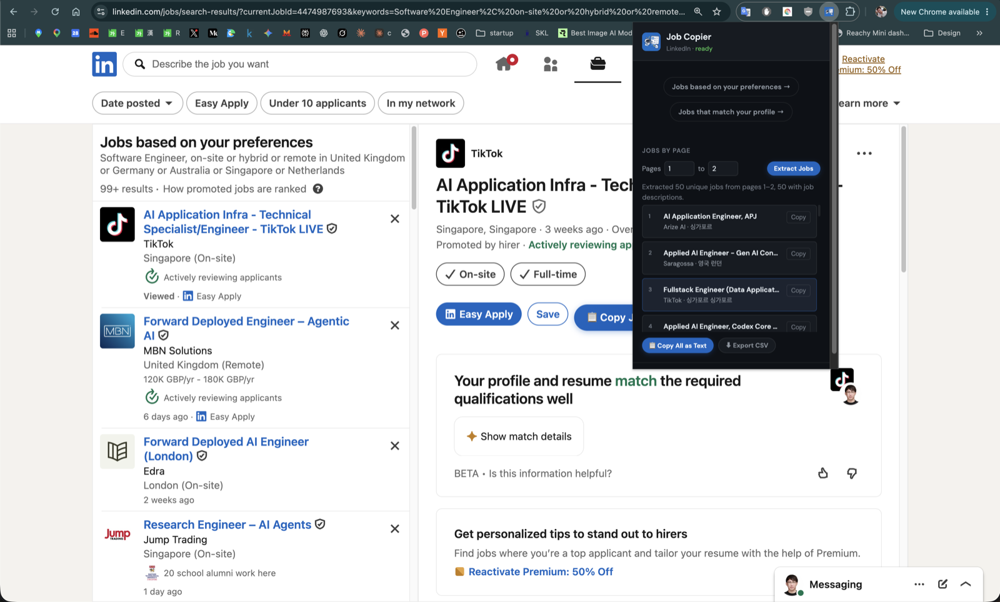
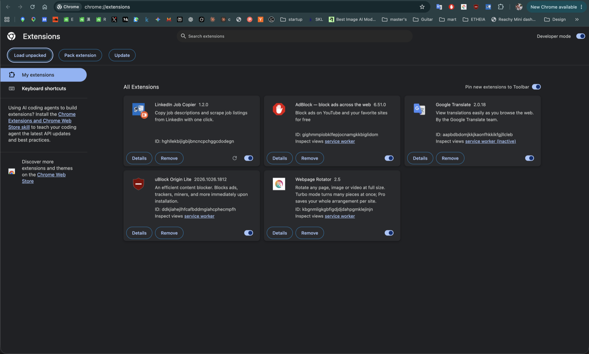
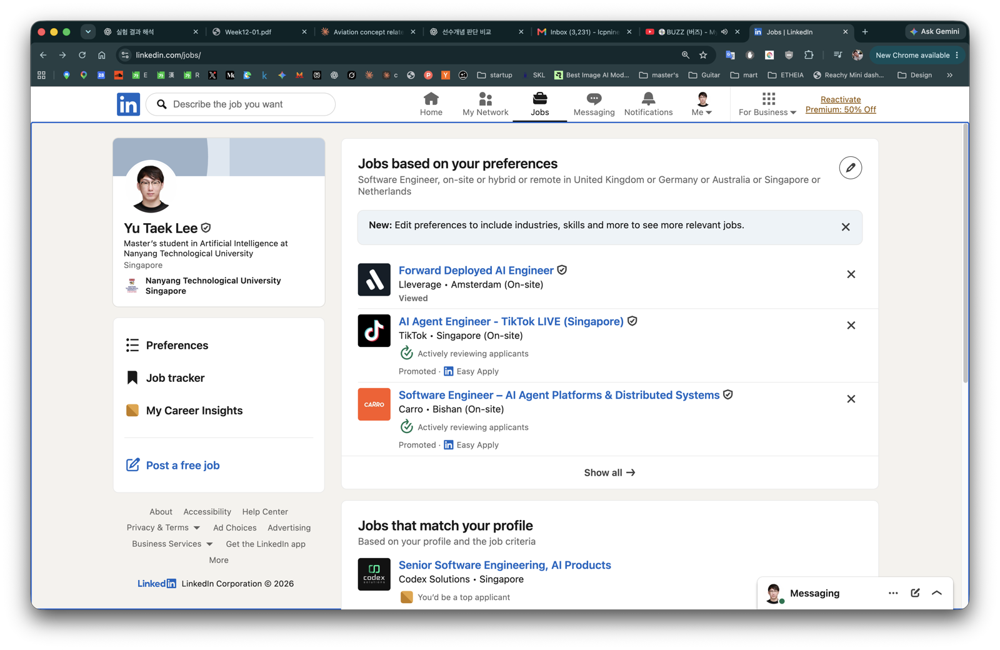

# LinkedIn Job Copier

**English** | [한국어](README.ko.md)

A free browser extension that saves you from copy-pasting LinkedIn job posts by hand.

- **Copy one job** with a single click: title, company, location, link and the full description, ready to paste into a document, a message, or ChatGPT/Claude.
- **Collect many jobs at once**: pick a range of search result pages (say, pages 1 to 3) and it gathers every job on them, with full descriptions. Selecting many pages at once can run into memory issues, so we recommend at most 3 pages at a time.
- **Save the list** as text or as a spreadsheet file (CSV) you can open in Excel, Numbers or Google Sheets.



**Works in:** Chrome, Edge, Brave, Arc, Vivaldi, Opera (any Chromium-based browser) on a computer. It does not work on phones, in Safari, or in Firefox without changes.

**Privacy:** everything runs inside your own browser. Nothing is sent to any server other than LinkedIn itself.

---

## Install it (about 2 minutes)

The extension isn't in the Chrome Web Store, so you install it from a folder. You only do this once.

### 1. Download the extension

1. On this GitHub page, click the green **Code** button, then **Download ZIP**.
2. Find the downloaded ZIP (usually in your **Downloads** folder) and double-click it to unzip.
3. Move the unzipped folder somewhere you won't delete it by accident, such as your **Documents** folder. The browser loads the extension from this folder, so **if you delete the folder, the extension stops working.**

### 2. Add it to your browser

1. Open a new tab and type this into the address bar, then press Enter:
   - Chrome: `chrome://extensions`
   - Edge: `edge://extensions`
   - Brave: `brave://extensions`
2. Turn on **Developer mode** with the switch in the **top-right corner**.
3. Click **Load unpacked** in the top-left.
4. Choose the folder you unzipped (the one that contains `manifest.json`) and click **Select**.

You should now see **LinkedIn Job Copier** in your list of extensions, with its switch turned on:



### 3. Pin it to your toolbar

Click the puzzle-piece icon (🧩) at the top-right of the browser, then click the pin next to **LinkedIn Job Copier**. Its blue icon now stays in your toolbar where you can click it.

> **Edge users:** if Edge asks whether to keep the extension, choose **Keep**.
> **Chrome users:** Chrome may occasionally show a notice about developer-mode extensions. That's expected for extensions installed this way; you can dismiss it.

---

## Use it

First, sign in to LinkedIn in the same browser.

### Collect jobs from several pages

1. Open a list of job search results. There are two easy ways:
   - **Let the extension do it (easiest):** click the extension icon in your toolbar, then **Jobs based on your preferences →** or **Jobs that match your profile →**. It works from any web page: the extension opens LinkedIn Jobs, clicks that section's **Show all** for you, and lands on the full list.
   - **Do it yourself:** on [linkedin.com/jobs](https://www.linkedin.com/jobs/), click **Show all** at the bottom of the **Jobs based on your preferences** or **Jobs that match your profile** section. (Searching for a job on LinkedIn as usual works too.)

   

   The page-range controls only appear on a search results list like this.
2. Click the extension icon. Under **JOBS BY PAGE**, type the pages you want, for example **1** to **3**, and click **Extract Jobs**.
3. Wait while the extension goes through the pages one by one. LinkedIn shows about 25 jobs per page, so 2 pages takes a minute or so. You can close the little window and keep browsing in the meantime; click the icon again to check on it, or press **Stop** to end early.
4. When it's done, you'll see a message like *"Extracted 50 unique jobs from pages 1–2"* and the list of jobs. Then:
   - **📋 Copy All as Text** copies every job and its description, so you can paste them anywhere.
   - **⬇ Export CSV** downloads a spreadsheet file. Open it with Excel, Numbers, or Google Sheets (*File → Import*).
   - **Copy** next to a single job copies just that one.

### Tip: let an AI find the jobs that fit you

Once you have the list, ask an AI assistant (ChatGPT, Claude, Gemini, etc.) to match it against your CV:

1. Click **📋 Copy All as Text** (or **⬇ Export CSV** to get a file).
2. Open the AI assistant and attach your CV (PDF or Word), or paste its text.
3. Paste the copied jobs (or attach the CSV file), and ask something like:

   > Here is my CV and a list of job postings. Pick the jobs that fit my experience best, rank them, and explain for each one why it fits and what I might be missing.

This turns reading 50+ job descriptions yourself into a short list of the ones worth applying to.

### Copy one job

1. Click any job on LinkedIn so its details open on the right side.
2. Click the blue **📋 Copy Job Description** button next to LinkedIn's **Save** button (you can see it in the first screenshot above).
3. Paste it wherever you need it.

---

## Common questions

**I don't see Extract Jobs / the page boxes.**
You're not on a LinkedIn search results list. Use one of the shortcut buttons in the extension, or search for a job on LinkedIn, and then open the extension again.

**The Copy Job Description button doesn't show up.**
Refresh the LinkedIn page (press F5, or ⌘R on a Mac). If you just installed the extension, LinkedIn tabs that were already open need a refresh before it works.

**Some jobs are missing their description.**
LinkedIn sometimes slows down requests when many are made quickly. Wait a few minutes and try a smaller page range.

**It stopped before the last page I asked for.**
That search simply doesn't have that many pages. The extension keeps everything it found up to that point.

**It stopped working entirely.**
LinkedIn changes its website from time to time, which can break the extension. Check this page for a newer version.

### Updating to a newer version

1. Download the ZIP again and unzip it.
2. Replace your old extension folder with the new one (keep the same location).
3. Go to `chrome://extensions` and click the **↻ reload** arrow on the LinkedIn Job Copier card.
4. Refresh any open LinkedIn tabs.

### Uninstalling

Go to `chrome://extensions` and click **Remove** on the LinkedIn Job Copier card. Then you can delete the folder.

---

## For developers

### How page-range extraction works

- It moves between pages by clicking LinkedIn's own pagination buttons (the **Page N** button, or **Next**/**Previous**), waits for the result list to change, and collects the job IDs of the cards on each page.
- It then reads each new job's title, company, location and full description from LinkedIn's public job-posting page (`/jobs-guest/jobs/api/jobPosting/{JOB_ID}`), 3 at a time, before moving to the next page.
- Jobs repeated across pages are kept once. If a requested page doesn't exist, it stops there and keeps what it has.
- It does not scroll the list, so only cards LinkedIn has rendered are collected.
- Progress continues if the popup is closed. Jobs that can't be read (for example when LinkedIn rate-limits) keep whatever the card showed.
- The CSV columns are `jobId,title,company,location,jobUrl,aboutTheJob`.
- The content script only runs on `linkedin.com/jobs/*`. If LinkedIn changes its markup, the structural selectors in `content.js` may need updating.

### Running the tests

```bash
node --test
```

### File structure

```
linkedin-job-copier/
├── manifest.json      # Extension config (Manifest V3)
├── content.js         # Injected into LinkedIn pages: Copy button and page-range extraction
├── content.css        # Styles for the injected button & toast
├── popup.html         # Extension popup UI
├── popup.css          # Popup styles
├── popup.js           # Popup logic
├── test/              # Test suite
├── docs/screenshots/  # Images used in this README
└── icons/
    ├── icon16.png
    ├── icon48.png
    └── icon128.png
```

---

Originally based on [PavanBJ/linkedin-job-copier](https://github.com/PavanBJ/linkedin-job-copier).
